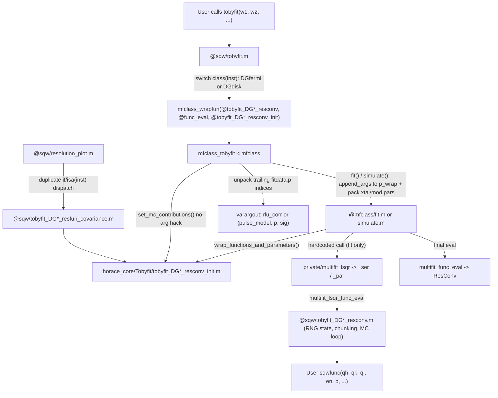
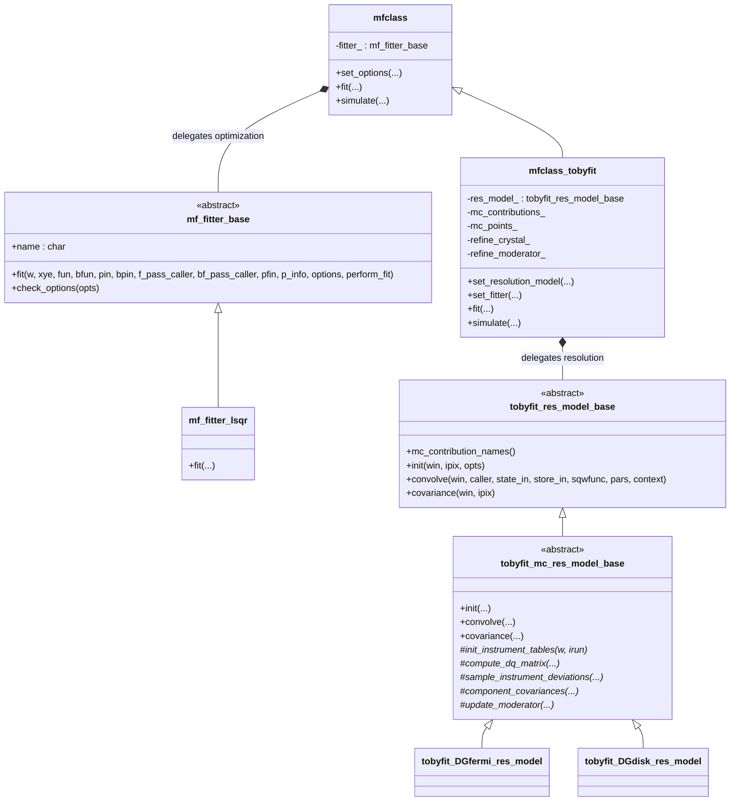

# Tobyfit Architecture Analysis & Refactoring Plan

This document captures the current design of **Tobyfit** (`horace_core/Tobyfit/` and `@sqw/tobyfit*`), its coupling with **Multifit** (`herbert_core/applications/multifit/@mfclass`), and a phased refactoring plan to extract both the **resolution convolution engine** and the **fitting algorithm** as clean, replaceable internal dependencies aligned with Horace/Herbert conventions (`snake_case`, trailing `_` private members, ADRs `0021`/`0022`/`0023`, and `matlab-horace-refactor` standards).

---

## 1. Current Design Structure

### 1.1 Component & File Inventory

| Layer | Location / Key Files | Current Responsibility |
| :--- | :--- | :--- |
| **User Entry Point (`@sqw`)** | [tobyfit.m](file:///c:/Users/wkc26243/Documents/DEVELOPMENT/Horace_fork/horace_core/sqw/@sqw/tobyfit.m) | Validates leading `sqw` objects (no file-backed pixels), inspects instrument class via `get_inst_class`, switches on `IX_inst_DGfermi` / `IX_inst_DGdisk`, builds `mfclass_wrapfun`, and constructs `mfclass_tobyfit`. |
| **Tobyfit Controller** | [mfclass_tobyfit.m](file:///c:/Users/wkc26243/Documents/DEVELOPMENT/Horace_fork/horace_core/Tobyfit/Tobyfit/@mfclass_tobyfit/mfclass_tobyfit.m) & methods ([fit.m](file:///c:/Users/wkc26243/Documents/DEVELOPMENT/Horace_fork/horace_core/Tobyfit/Tobyfit/@mfclass_tobyfit/fit.m), [simulate.m](file:///c:/Users/wkc26243/Documents/DEVELOPMENT/Horace_fork/horace_core/Tobyfit/Tobyfit/@mfclass_tobyfit/simulate.m), `set_mc_*`, `set_refine_*`, `set_fun`, `set_bfun`, `private/*_parse.m`) | Subclasses `mfclass`. Stores `mc_contributions_`, `mc_points_`, `refine_crystal_`, `refine_moderator_`. Packs MC/refinement state into `wrapfun.p_wrap` via `append_args`, delegates to `fit@mfclass` / `simulate@mfclass`, and slices trailing fit parameters for `rlu_corr` or `fitmod`. |
| **Multifit Engine (`herbert_core`)** | [mfclass.m](file:///c:/Users/wkc26243/Documents/DEVELOPMENT/Horace_fork/herbert_core/applications/multifit/@mfclass/mfclass.m), [fit.m](file:///c:/Users/wkc26243/Documents/DEVELOPMENT/Horace_fork/herbert_core/applications/multifit/@mfclass/fit.m), [simulate.m](file:///c:/Users/wkc26243/Documents/DEVELOPMENT/Horace_fork/herbert_core/applications/multifit/@mfclass/simulate.m), [mfclass_wrapfun.m](file:///c:/Users/wkc26243/Documents/DEVELOPMENT/Horace_fork/herbert_core/applications/multifit/@mfclass_wrapfun/mfclass_wrapfun.m), [multifit_lsqr.m](file:///c:/Users/wkc26243/Documents/DEVELOPMENT/Horace_fork/herbert_core/applications/multifit/@mfclass/private/multifit_lsqr.m) | Generic multi-dataset parameter/binding/masking manager. Wraps user `fun`/`bfun` via `mfclass_wrapfun`, then **hardcodes** Levenberg-Marquardt least-squares minimization via private `multifit_lsqr` (`multifit_lsqr_ser` / `multifit_lsqr_par`). |
| **Resolution Convolution (`@sqw`)** | [tobyfit_DGfermi_resconv.m](file:///c:/Users/wkc26243/Documents/DEVELOPMENT/Horace_fork/horace_core/sqw/@sqw/tobyfit_DGfermi_resconv.m), [tobyfit_DGdisk_resconv.m](file:///c:/Users/wkc26243/Documents/DEVELOPMENT/Horace_fork/horace_core/sqw/@sqw/tobyfit_DGdisk_resconv.m), [tobyfit_DGfermi_resfun_covariance.m](file:///c:/Users/wkc26243/Documents/DEVELOPMENT/Horace_fork/horace_core/sqw/@sqw/tobyfit_DGfermi_resfun_covariance.m), [tobyfit_DGdisk_resfun_covariance.m](file:///c:/Users/wkc26243/Documents/DEVELOPMENT/Horace_fork/horace_core/sqw/@sqw/tobyfit_DGdisk_resfun_covariance.m), [resolution_plot.m](file:///c:/Users/wkc26243/Documents/DEVELOPMENT/Horace_fork/horace_core/sqw/@sqw/resolution_plot.m) | Instrument-specific MC convolution and covariance methods placed directly inside `@sqw/`. Heavy duplication (~85–90%) between `DGfermi` and `DGdisk`. `resolution_plot` repeats the `IX_inst_DGfermi` / `IX_inst_DGdisk` dispatch logic. |
| **Physics & Lookup Helpers** | `horace_core/Tobyfit/` ([tobyfit_DGfermi_resconv_init.m](file:///c:/Users/wkc26243/Documents/DEVELOPMENT/Horace_fork/horace_core/Tobyfit/tobyfit_DGfermi_resconv_init.m), [tobyfit_DGdisk_resconv_init.m](file:///c:/Users/wkc26243/Documents/DEVELOPMENT/Horace_fork/horace_core/Tobyfit/tobyfit_DGdisk_resconv_init.m), [dq_matrix_DGfermi.m](file:///c:/Users/wkc26243/Documents/DEVELOPMENT/Horace_fork/horace_core/Tobyfit/dq_matrix_DGfermi.m), [dq_matrix_DGdisk.m](file:///c:/Users/wkc26243/Documents/DEVELOPMENT/Horace_fork/horace_core/Tobyfit/dq_matrix_DGdisk.m), `instpars_*`, `detector_array.m`, `detector_info.m`, `energy_transfer_info.m`, `sample_coords_to_spec_to_rlu.m`, `refine_moderator_strip_pars.m`) | Precompute lookup tables (`object_lookup`), wavevectors, transformation matrices, and per-instrument Jacobian matrices (`dq_mat`, `4 x 11 x npix`). |
| **Legacy Stubs & Tests** | `tobyfit_mc_contributions.m`, `tobyfit_refine_*_options.m`; `_test/test_TF_components/`, `_test/test_TF_let/`, `_test/test_TF_refine_crystal/` | Deprecated 2018 functions; system tests covering DGfermi/DGdisk MC components, `resolution_plot` covariances, moderator refinement, and crystal refinement. |

### 1.2 Current Control & Data Flow

### 1.3 Key Structural Pain Points & Findings

1. **Tight, Scattered Coupling of the Resolution Model**:
   - Instrument-specific resolution physics (`tobyfit_DGfermi_resconv`, `tobyfit_DGdisk_resconv`, and `*_resfun_covariance`) live on `@sqw` instead of in a dedicated resolution-model hierarchy.
   - Instrument type branching (`IX_inst_DGfermi` vs `IX_inst_DGdisk`) is duplicated in `@sqw/tobyfit.m` and `@sqw/resolution_plot.m`.
   - `mfclass_tobyfit` communicates configuration to the resolution function by mutating `obj_tmp.wrapfun.p_wrap` with positional trailing arguments `(mc_contributions, mc_points, xtal, modshape)` on every `fit`/`simulate` call, and queries allowed MC components via `[~,~,mc_contr] = obj.wrapfun.func_init()`.
   - Adding a new resolution model (e.g., 4D Gaussian covariance approximation, analytical resolution, triple-axis, indirect geometry, or fast/MEX MC kernel) currently requires adding files to `@sqw/` and editing multiple `switch/if` dispatchers.
2. **Hardcoded Fitting Algorithm inside `mfclass`**:
   - `@mfclass/fit.m` invokes private `multifit_lsqr` directly—there is no abstraction for the optimizer/fitter (e.g., swapping Levenberg-Marquardt for `lsqnonlin`, Trust-Region, Nelder-Mead/simplex, MCMC, or custom objective solvers) without duplicating `@mfclass/fit.m`.
   - `mfclass_tobyfit/fit.m` embeds fragile assumptions about parameter vector layout (`fitdata.p(end-8:end)` for crystal refinement and `fitdata.p(end-npmod+1:end)` for moderator refinement) and couples crystal/moderator refinement parameter packing directly to `mfclass` bindings.
3. **Massive Code Duplication (~85–90%) Across DGfermi & DGdisk**:
   - `tobyfit_DGfermi_resconv.m` (320 lines) and `tobyfit_DGdisk_resconv.m` (322 lines) are identical except for lookup extraction, `dq_matrix_DG*`, and moderator/aperture/chopper vs `mod_shape_mono`/divergence sampling.
   - `tobyfit_DGfermi_resconv_init.m` (314 lines) and `tobyfit_DGdisk_resconv_init.m` (309 lines) duplicate argument parsing, pixel indexing, `energy_transfer_info`, `sample_coords_to_spec_to_rlu`, mosaic checking, `detector_array`, and `dt` calculation.
   - `tobyfit_DGfermi_resfun_covariance.m` (197 lines) and `tobyfit_DGdisk_resfun_covariance.m` (195 lines) duplicate projection checks, matrix transforms (`transform_matrix`, `invert_matrix`), and `cov_hkle`/`cov_proj`/`cov_spec` assembly.
4. **Directory Structure, Error Handling, and Latent Bugs Discovered**:
   - Awkward double nesting: `horace_core/Tobyfit/Tobyfit/@mfclass_tobyfit/` alongside empty `Contents.m` files.
   - ADR 0021 / 0023 violations: `error(mess)` in `@mfclass_tobyfit/fit.m`, `set_mc_*`, `set_refine_*`; `try/catch error(ME.message)` stripping stack/ID in `set_bfun.m`.
   - Bugs spotted during inspection:
     - `tobyfit_DGdisk_resconv.m` (L150–153): `for i=1:numel(mod_shape_mono); mod_shape_mono.moderator = moderator; end` misses `(i)` indexing and aliases loop variable `i`.
     - `mfclass_tobyfit/private/refine_moderator_parse.m` (L68, L73): references `mod_opts_default.pulse_shape` instead of `mod_opts_default.pulse_model` in 1-arg / 2-arg paths.
     - `mfclass_tobyfit/set_refine_crystal.m` (L109): error message states `"not possible to set moderator refinement options"`.

---

## 2. Target Architecture: Replaceable Internal Dependencies

The refactoring extracts two orthogonal strategy hierarchies—**Resolution Model** and **Fitting Algorithm**—using composition/dependency injection rather than static `@sqw` methods and hardcoded private solver calls.

### 2.1 Component Diagram (Proposed)

### 2.2 Dependency 1: Replaceable Resolution Convolution Model (`tobyfit_res_model_base`)

- **Interface Contract**: Define an abstract base class (e.g., `@tobyfit_res_model_base` under `horace_core/Tobyfit/`) responsible for:
  1. `mc_contribution_names(obj)` — replaces the undocumented 0-arg `func_init()` overload.
  2. `init(obj, win, varargin)` — builds the precomputed lookup/context structure once per masked or unmasked dataset.
  3. `convolve(obj, win, caller, state_in, store_in, sqwfunc, pars, lookup, mc_contributions, mc_points, xtal, modshape)` — executes resolution broadening (matching `mfclass_wrapfun` or via a thin adapter bound to the active `res_model_` instance).
  4. `covariance(obj, win, ipix)` — returns `[cov_proj, cov_spec, cov_hkle]` for `resolution_plot` and diagnostics.
- **Template Method for Shared MC Mechanics (`tobyfit_mc_res_model_base`)**:
  - Centralizes ~85% of currently duplicated code: argument validation, RNG `state_in`/`state_out` capture & restore, pixel chunking (`mem_chunk_size / 10`), crystal/moderator parameter stripping, `detector_array` / `detector_info` / `energy_transfer_info` / `sample_coords_to_spec_to_rlu` lookup building, `calculate_q`, mosaic sampling (`rand_mosaic`), `mtimesx_horace` transformations, `recompute_bin_data`, and covariance frame transforms (`cov_hkle`, `cov_proj`, `cov_spec`).
  - Subclasses (`tobyfit_DGfermi_res_model`, `tobyfit_DGdisk_res_model`) only override ~4 small protected hooks (`init_instrument_tables_`, `compute_dq_matrix_`, `sample_instrument_deviations_`, `component_covariances_`, `update_moderator_`).
- **Resolution Model Factory / Instrument Registry**:
  - Extract instrument-to-model selection out of both `@sqw/tobyfit.m` and `@sqw/resolution_plot.m` into a single factory helper (e.g., `tobyfit_get_res_model(inst)` returning `tobyfit_DGfermi_res_model` or `tobyfit_DGdisk_res_model`), easily extensible to custom models (e.g., analytical Gaussian resolution or user-supplied `tobyfit_res_model_base` subclasses) via `mfclass_tobyfit.set_resolution_model(...)` or an optional keyword to `tobyfit(w, 'res_model', ...)`.
- **Backward Compatibility**:
  - `@sqw/tobyfit_DGfermi_resconv.m`, `@sqw/tobyfit_DGdisk_resconv.m`, `@sqw/tobyfit_DG*_resfun_covariance.m`, and `tobyfit_DG*_resconv_init.m` remain as thin `@sqw`/Tobyfit wrappers (optionally emitting deprecation warnings or delegating cleanly to the new model classes) so external scripts calling them directly do not break.

### 2.3 Dependency 2: Replaceable Fitting Algorithm (`mf_fitter_base` / optimizer strategy)

- **Abstraction Boundary in `mfclass` (`herbert_core/applications/multifit/`)**:
  - Extract the Levenberg-Marquardt solver out of `private/multifit_lsqr.m` (`_ser`/`_par`) into a strategy hierarchy rooted at `@mf_fitter_base` (with default implementation `@mf_fitter_lsqr`).
  - **Clean Objective/Residual Adapter**: `mf_fitter_base.fit(...)` receives a standard problem context (evaluator handle wrapping `multifit_lsqr_func_eval`, data values `yval`, weights `wt`, initial free parameters `pfin`, `p_info`, fit control parameters/options, `perform_fit`) and returns standardized `[p_best, sig, cor, chisqr_red, converged]`.
  - Keep `multifit_lsqr_ser` and `multifit_lsqr_par` behavior bit-for-bit identical as the default `mf_fitter_lsqr` strategy so RNG call counts, finite-difference Jacobians, and all existing `mfclass` / `Tobyfit` tolerances pass unchanged.
- **Injection API**:
  - Allow setting the fitter via `obj = obj.set_fitter(fitter_obj_or_handle)` (or via `set_options('fitter', ...)` / property `fitter`), working seamlessly on `mfclass`, `mfclass_Horace`, and `mfclass_tobyfit`.
  - Enables plugging alternative optimizers (e.g., constrained trust-region / `lsqnonlin`, Nelder-Mead derivative-free search for noisy MC evaluations, or global/Bayesian samplers) without modifying `mfclass/fit.m` or `mfclass_tobyfit/fit.m`.
- **Decoupling Refinement Parameter Packing**:
  - Encapsulate crystal and moderator refinement parameter packing/unpacking in helper strategy/spec objects (instead of hardcoded `end-8:end` slicing inside `@mfclass_tobyfit/fit.m`), making parameter extraction independent of how parameters are appended or ordered.

---

## 3. Phased Execution Plan

### Phase 1: Baseline Verification & Unit Test Harness
1. Run the existing system tests in MATLAB (`_test/test_TF_components`, `_test/test_TF_let`, `_test/test_TF_refine_crystal`, `_test/test_sqw_class/test_multifit_functions`, and `herbert_core` multifit tests) to capture an exact passing baseline.
2. Add focused unit tests for `mc_contributions_parse`, `refine_crystal_parse`, `refine_moderator_parse` (including the latent `pulse_shape` bug), and direct resolution covariance/evaluation parity.

### Phase 2: Extract Fitting Algorithm Dependency (`herbert_core/applications/multifit/`)
1. Define `@mf_fitter_base` (abstract solver contract) and `@mf_fitter_lsqr` wrapping the existing `multifit_lsqr_ser` / `multifit_lsqr_par` logic (preserving parallel/serial dispatch via `hpc_config`).
2. Add `fitter_` (`@mf_fitter_base`, default `mf_fitter_lsqr`) to `@mfclass`, expose `set_fitter` / `fitter` dependent property, and update `@mfclass/fit.m` to call `obj.fitter_.fit(...)`.
3. Verify zero regressions across `herbert_core` multifit tests and all `horace_core` / `test_TF_*` suites.
4. Add unit tests verifying a mock/custom `mf_fitter_base` subclass (e.g., alternative optimizer / Nelder-Mead or test spy) can be injected into both `mfclass` and `mfclass_tobyfit`.

### Phase 3: Extract Resolution Convolution Model Dependency (`horace_core/Tobyfit/`)
1. Create `@tobyfit_res_model_base`, `@tobyfit_mc_res_model_base` (shared MC convolution, initialization, crystal/moderator parameter stripping, and covariance calculations), `@tobyfit_DGfermi_res_model`, `@tobyfit_DGdisk_res_model`, and `tobyfit_get_res_model.m` factory.
2. Fix the `tobyfit_DGdisk_resconv` multi-run `mod_shape_mono` indexing bug during consolidation.
3. Convert `@sqw/tobyfit_DG*_resconv.m`, `@sqw/tobyfit_DG*_resfun_covariance.m`, and `horace_core/Tobyfit/tobyfit_DG*_resconv_init.m` into thin delegation wrappers preserving backward-compatible signatures.
4. Refactor `@sqw/resolution_plot.m` and `@sqw/tobyfit.m` to obtain their resolution model from `tobyfit_get_res_model` (plus allow optional override on `tobyfit` / `mfclass_tobyfit.set_resolution_model`).
5. Refactor `@mfclass_tobyfit` to hold `res_model_` directly (removing the 0-arg `func_init()` trick and delegating `set_resolution_model`, rebuilding `wrapfun` cleanly on model swap).

### Phase 4: Modernization, Refinement Helpers & Cleanup
1. Clean up parameter packing/unpacking for crystal and moderator refinement (removing fragile `end-8:end` assumptions and fixing `refine_moderator_parse.m` `pulse_shape` typo + `set_refine_crystal.m` error text).
2. Standardize error identifiers (`HORACE:mfclass_tobyfit:...`, `HERBERT:mfclass:...`, ADR `0021`/`0023`), `parse_arguments` (ADR `0022`), and docstrings across touched files.
3. Re-run the complete TF & multifit test suites plus new dependency-injection unit tests (verifying custom `tobyfit_res_model_base` replacement, e.g., deterministic/no-MC or Gaussian-covariance model).

---

## 4. Open Design Decisions for Consultation

Before modifying any code, please confirm your preferences on these architectural choices:

1. **Scope of Fitter Abstraction (`@mfclass` vs `@mfclass_tobyfit` only)**:
   - *Recommended*: Place `mf_fitter_base` and `set_fitter(...)` on `mfclass` in `herbert_core` so `mfclass`, `mfclass_Horace`, and `mfclass_tobyfit` all benefit uniformly from replaceable optimization algorithms.
   - *Alternative*: Wrap/override `fit` solely inside `mfclass_tobyfit` without touching `herbert_core`.
2. **Replacement Granularity & Public API**:
   - Should the resolution model and fitting algorithm be purely *internal* replaceable dependencies (configurable via `set_resolution_model` / `set_fitter` or constructor/options for testing and extensibility), or also exposed via keyword arguments on `tobyfit(w, 'res_model', ..., 'fitter', ...)`?
   - Note that we will keep `tobyfit(w)` with default arguments behaving identically to today (`tobyfit_DGfermi/DGdisk_res_model` + `mf_fitter_lsqr`).
3. **Second Built-in Fitter / Resolution Model Implementation**:
   - Beyond extracting `mf_fitter_lsqr` (Levenberg-Marquardt) and `tobyfit_DGfermi_res_model` / `tobyfit_DGdisk_res_model` (+ test mocks), do you want a concrete second built-in implementation included in this refactoring (for example, `fminsearch` / Nelder-Mead or `lsqnonlin` fitter, or a Gaussian-covariance resolution model using `resfun_covariance`)?
4. **Deprecated `@sqw/tobyfit_DG*` Methods & Folder Cleanup**:
   - Keep `@sqw/tobyfit_DGfermi_resconv.m`, `@sqw/tobyfit_DGdisk_resconv.m`, and `tobyfit_DG*_resfun_covariance.m` as thin delegating wrappers for backward compatibility, or move/deprecate them completely?
   - Also, should we leave the nested `horace_core/Tobyfit/Tobyfit/@mfclass_tobyfit` folder path as-is to avoid breaking path assumptions in startup/CI scripts, or flatten it under `horace_core/Tobyfit/`?
